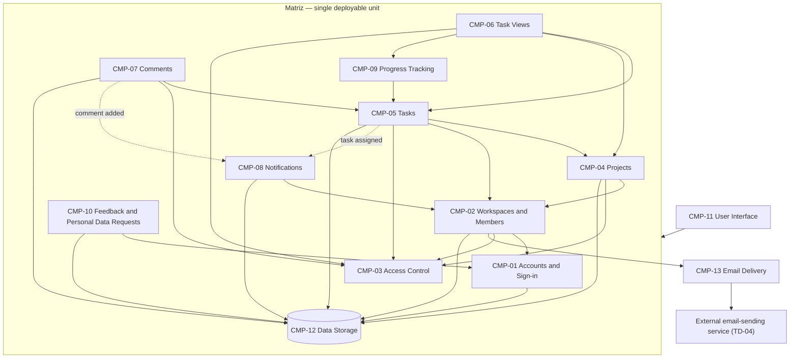

# Matriz — Architecture

> **Status:** decided on 2026-11-05 by the project decision-maker (KC-01). This decision covers the architectural style and the logical components of the MVP only. No language, framework, data store product, hosting provider or tool has been chosen; those choices are listed under [Pending decisions](#pending-decisions). Requirement IDs are defined in [requirements.md](requirements.md), user stories in [user-stories.md](user-stories.md), and constraints, assumptions and pending decisions in [constraints.md](constraints.md).

## Context

The MVP is limited to FR-01 to FR-21 and NFR-01 to NFR-10 ([MVP scope](requirements.md#mvp-scope)). The forces that shape the architecture are:

| Force | Source | Status |
|---|---|---|
| The development team is one person, the project decision-maker. | KC-08 | Fact |
| The budget is limited. | KC-04, AQ29 | **Assumption** |
| The first release is expected within a few months, with no fixed deadline. | KC-05, AQ30 | **Assumption** |
| The pilot has tens of teams and up to a few hundred users; growth to thousands is possible within one to three years. | NFR-05, AQ25 | **Assumption** |
| Each organization can see and change only its own data. | NFR-01, SP-02 | Requirement (basis: AQ24, **assumption**) |
| No successfully saved change is lost. | NFR-03 | Requirement (basis: AQ27, **assumption**) |
| Availability during working hours; brief interruptions are tolerable. | NFR-04 | Requirement (basis: AQ27, **assumption**); target pending PD-15 |
| Strict data-protection rules apply; personal-data requests may be handled manually. | NFR-02, FR-21 | Requirement (basis: AQ24, **assumption**) |
| The product will change after the pilot: 23 product decisions are still pending, 27 features are planned for later releases and 3 are not planned. | [Pending product decisions](constraints.md#pending-product-decisions), [Features outside the initial scope](requirements.md#features-outside-the-initial-scope), OBJ-05 | Fact about the documentation |
| No technology has been chosen. | KC-03 | Fact |

The last two forces matter as much as the first: the MVP must be cheap to build and run, and it must also be easy to change once the pending decisions are made and pilot feedback arrives.

## Options considered

Three architectural styles were compared using the same seven criteria.

- **Monolith:** one deployable unit with no enforced internal boundaries.
- **Modular monolith:** one deployable unit divided into modules with explicit responsibilities, public interfaces and data ownership.
- **Microservices:** several independently deployed services, each owning its data and communicating over the network.

| Criterion | Monolith | Modular monolith | Microservices |
|---|---|---|---|
| **Development complexity** | Lowest at the start. | Low. Requires discipline to keep module boundaries, a small cost up front. | High. Network calls, distributed data, and workspace isolation (NFR-01) and permissions (FR-04) repeated in every service. |
| **Speed of delivery** | Fastest start. | Nearly as fast as a monolith. | Slowest: deployment, monitoring and inter-service communication must exist before the first feature ships (conflicts with AQ30). |
| **Maintainability** | Degrades as features are added: permission rules and data access spread across the code. Risky given 23 pending decisions and 27 later features. | Good. Most pending decisions change one module (for example PD-01, PD-02 and PD-17 change Access Control). Later features have a natural place. | Strong boundaries, but decisions that span several FRs (most PDs do) need coordinated changes across services. |
| **Scalability** | Scales as a whole unit. Enough for the pilot load (NFR-05, AQ25). | Same as a monolith. A module can be extracted later if it alone needs to scale. | Independent scaling per service, which the pilot load (NFR-05, AQ25) does not need. |
| **Operational and deployment effort** | Lowest: one unit, one data store. | Lowest: one unit, one data store. Manageable by one person. | Highest: many deployable units, each to monitor, secure and back up. Not manageable by one person on a limited budget (AQ29), and each service is a new point of failure for NFR-04. |
| **Testing** | Simple end-to-end tests. Isolating business rules gets harder over time. | Modules can be tested in isolation and end-to-end. NFR-01 and NFR-03 can be checked at one data-access boundary. | Hardest: contract and integration testing across services. NFR-03 is harder without a single transaction, for example deleting a task while keeping progress counts correct (AC-17.3). |
| **Fit with the MVP and constraints** | Good for the pilot, weak for the changes expected after it. | Best fit: low cost now, room to change later. | Poor fit: costs that the MVP's size, team and load do not justify. |

## Decision

**The MVP of Matriz is built as a modular monolith:** a single deployable unit with one logical data store, divided into the modules listed under [Components and responsibilities](#components-and-responsibilities).

The modules follow four rules:

1. **Explicit interfaces.** A module uses another module only through that module's public interface, never through its internal code or its data.
2. **Data ownership.** Each module owns its data. No module reads or changes another module's data directly.
3. **One-way dependencies.** Module dependencies form no cycles. Where a module must react to something that happens in another, it subscribes to an event the other module publishes inside the application (for example, Notifications reacts to "task assigned" from Tasks).
4. **Workspace scoping.** Every record that belongs to a workspace is marked with its workspace, and every read or change is limited to the signed-in member's workspace (NFR-01, SP-02).

| Approved by | Date |
|---|---|
| Project decision-maker | 2026-11-05 |

## Justification

### Why the modular monolith fits the MVP

- **One person can build and run it.** With a one-person team, a limited budget (AQ29, **assumption**) and a first release within a few months (AQ30, **assumption**), a single deployable unit keeps setup, deployment, monitoring and backup (TD-05, TD-06) to one of each.
- **It handles the expected load.** The pilot of tens of teams and a few hundred users (NFR-05, AQ25, **assumption**) does not require independent scaling of parts of the system.
- **It makes the critical non-functional requirements simple to meet.** One data store lets related changes be saved together or not at all, which protects saved work (NFR-03) and keeps progress counts consistent with tasks (FR-18, AC-17.2, AC-17.3). Workspace isolation (NFR-01) is enforced at one data-access boundary instead of in every service.
- **It absorbs the pending decisions.** Many pending product decisions change rules inside one area: permissions (PD-01, PD-02, PD-03, PD-17), task rules (PD-04, PD-06, PD-11) or progress rules (PD-07, PD-08). Module boundaries keep each change contained.
- **It keeps the growth path open.** If a module later needs to scale or be released separately (see [Conditions for revisiting the decision](#conditions-for-revisiting-the-decision)), its explicit interface and its own data make it possible to extract.

### Why the other options were rejected

- **Monolith:** it would be marginally faster to start, but nothing would stop permission checks, workspace scoping and task rules from spreading across the code. With 23 pending decisions and 27 later features, that would make every change riskier, especially for NFR-01 and SP-03, where a missed check is a data leak.
- **Microservices:** they solve problems Matriz does not have yet (independent scaling, many teams releasing in parallel) and add costs it cannot carry: several deployable units for one person, network failures that threaten NFR-04, and cross-service consistency that threatens NFR-03.

### Trade-offs and risks accepted

- **The whole unit scales and fails together.** A fault in one module can affect all of Matriz. This is accepted because NFR-04 tolerates brief interruptions (AQ27, **assumption**).
- **Boundaries depend on discipline.** Nothing in the deployment stops one module from reaching into another. How boundaries are checked is a pending decision (TD-12).
- **All modules are released together.** A change to one module means redeploying the whole unit. With one developer, this costs little.
- **A small up-front cost.** Defining interfaces and data ownership takes slightly more effort than a plain monolith.

## Consequences

### Positive

- One unit to build, test, deploy, monitor and back up.
- Workspace isolation (NFR-01) and no loss of saved work (NFR-03) are enforced in one place.
- Permission rules (FR-04, FR-05) live in one module, Access Control, so the outcomes of PD-01, PD-02, PD-03 and PD-17 change one place.
- Each FR has a clear owning module (see [Requirement coverage](#requirement-coverage)), which supports traceability under AGENTS.md W3.
- Modules can be extracted into separate services later without redesigning their responsibilities.

### Negative

- No independent scaling or independent release of modules.
- A defect in one module can take down the whole unit.
- Boundary rules must be checked continuously, or the design will drift towards a plain monolith.
- Events inside the application add a little indirection compared with direct calls.

## Components and responsibilities

Component IDs (CMP-xx) are new in this document. Names use the terminology of the existing documentation.

### Feature modules

| ID | Component | Responsibilities | Related FRs / user stories | Main dependencies |
|---|---|---|---|---|
| CMP-01 | **Accounts and Sign-in** | Creates personal accounts (one per person), handles sign-in and sign-out, and identifies the signed-in person for every request. Accounts are person-level, not workspace-level, so they work whichever way PD-16 is decided. | FR-01, SP-01; US-01 | Data Storage |
| CMP-02 | **Workspaces and Members** | Creates workspaces. Sends, tracks and accepts invitations by email address. Deactivates members. Assigns and changes roles. Refuses duplicate members and keeps at least one Workspace Administrator. Provides each member's role and status to other modules. | FR-02, FR-03, FR-04 (role assignment), SP-04, SP-07; US-02, US-03, US-04, US-05; EC-01, EC-02, EC-03 | Accounts and Sign-in, Access Control, Email Delivery, Data Storage |
| CMP-03 | **Access Control** | Holds the permission rules in one place: what each of the four roles (Workspace Administrator, Project Manager, Team Member, Viewer) may see and change, the Viewer's read-only access, and the rule that a member can delete only the tasks they created. Other modules ask it before every action and pass the facts it needs (the member's role, project membership, task creator). | FR-04 (permissions), FR-05, FR-09 (deletion rule), SP-03; US-19; AC-03.4, AC-11.3, AC-19.2 | None (it receives the facts it needs from the asking module) |
| CMP-04 | **Projects** | Creates, edits and archives projects (name, description, owner, start date, due date). Manages project members, including Viewers. Lists all projects in the workspace with owner and due date. | FR-06, FR-07, FR-08; US-06, US-07, US-08, US-09, US-19 (AC-19.1); EC-09 | Workspaces and Members, Access Control, Data Storage |
| CMP-05 | **Tasks** | Creates, edits and deletes tasks, with a required title and a description, and records who created each task. Keeps exactly one owner per task, who must be a project member. Holds due dates and the three statuses (To do, In progress, Done; new tasks start as To do). Keeps tasks of deactivated members. Publishes "task assigned" and "task status changed" events. | FR-09, FR-10, FR-11, FR-12; US-10, US-11; EC-04, EC-06, EC-07, EC-09 | Projects, Workspaces and Members, Access Control, Data Storage |
| CMP-06 | **Task Views** | Provides the project task list (owner, status, due date), "My tasks" across projects ordered by due date with the earliest first, and filters by owner, status or due date. Shows the overdue marking supplied by Progress Tracking. | FR-13, FR-14, FR-15; US-12, US-13, US-14, US-19; AC-18.4 | Tasks, Projects, Progress Tracking, Access Control |
| CMP-07 | **Comments** | Adds comments to tasks and refuses empty or space-only comments. Publishes a "comment added" event. | FR-16; US-15; EC-08 | Tasks, Access Control, Data Storage |
| CMP-08 | **Notifications** | Creates in-app notifications when a member is assigned a task and when someone comments on a task they own, and shows each member their notifications. | FR-17; US-16 | Tasks and Comments (subscribes to their events), Workspaces and Members, Data Storage |
| CMP-09 | **Progress Tracking** | Derives each project's progress as "N of M tasks done" (including "0 of 0 tasks done") and decides whether a task is overdue: due date earlier than today and status not Done; a task without a due date is never overdue. | FR-18, FR-19; US-17, US-18; EC-05, EC-06 | Tasks |
| CMP-10 | **Feedback and Personal Data Requests** | Receives feedback (problem reports and suggestions) from members. Records requests for a copy or deletion of personal data, so the support team can handle them manually in the MVP. | FR-20, FR-21, SP-05, NFR-02; US-20, US-21 | Accounts and Sign-in, Data Storage |

### Cross-cutting elements

| ID | Component | Responsibilities | Related requirements | Main dependencies |
|---|---|---|---|---|
| CMP-11 | **User Interface** | Presents every MVP function on a computer, in the launch language. Every function is usable without a mouse, and no information relies on colour alone (including the overdue marking). Combines data from several modules on one screen, for example the project list with each project's progress (AC-17.1). Hides actions that Access Control does not allow. | All user-facing FRs, NFR-06, NFR-07, NFR-08, NFR-09; AC-18.1 | All feature modules, through their public interfaces |
| CMP-12 | **Data Storage** | Holds the data of all modules in one logical store, with each module owning its own data. Limits every read and change to the signed-in member's workspace. Saves the changes of one action together or not at all. Stores no payment data. | NFR-01, NFR-03, NFR-05, NFR-10, SP-02, SP-06 | None |
| CMP-13 | **Email Delivery** | Sends invitation emails. It is not used for email notifications (F37), which are outside the initial scope. | FR-03; AC-03.1 | An external email-sending service, pending TD-04 |

The progress indicator is shown in the project list (AC-17.1), but Projects does not depend on Progress Tracking. The User Interface combines the two, which keeps the dependency between Projects, Tasks and Progress Tracking one-way.

### Requirement coverage

| FR | Covered by |
|---|---|
| FR-01 Sign up and sign in | CMP-01 |
| FR-02 Workspace creation | CMP-02 |
| FR-03 Invite and remove members | CMP-02, CMP-13 |
| FR-04 Roles and permissions | CMP-02, CMP-03 |
| FR-05 Read-only access | CMP-03, CMP-11 |
| FR-06 Create, edit and archive projects | CMP-04 |
| FR-07 Project members | CMP-04 |
| FR-08 Project list | CMP-04, CMP-11 |
| FR-09 Create, edit and delete tasks | CMP-05, CMP-03 |
| FR-10 Assign a responsible person | CMP-05 |
| FR-11 Due dates | CMP-05 |
| FR-12 Task status | CMP-05 |
| FR-13 Project task list | CMP-06 |
| FR-14 "My tasks" | CMP-06 |
| FR-15 Filter tasks | CMP-06 |
| FR-16 Task comments | CMP-07 |
| FR-17 In-app notifications | CMP-08 |
| FR-18 Project progress indicator | CMP-09, CMP-11 |
| FR-19 Overdue highlighting | CMP-09, CMP-06, CMP-11 |
| FR-20 Send feedback | CMP-10 |
| FR-21 Personal data requests | CMP-10 |

| NFR | Addressed by |
|---|---|
| NFR-01 Workspace data isolation | CMP-12 (workspace scoping), decision rule 4 |
| NFR-02 Data protection | CMP-10, CMP-12; details pending TD-02, TD-09, PD-18, PD-19 |
| NFR-03 No loss of saved work | CMP-12; details pending TD-05 |
| NFR-04 Availability during working hours | The single deployable unit; target pending PD-15, approach pending TD-06 |
| NFR-05 Capacity | The single deployable unit, scaled as a whole; targets pending PD-15 |
| NFR-06 Accessibility | CMP-11 |
| NFR-07 Learnability | CMP-11 |
| NFR-08 Primary use on computers | CMP-11; access method pending TD-01 |
| NFR-09 One interface language | CMP-11; language pending PD-13 |
| NFR-10 Data sensitivity | CMP-12 stores no payment data; no component handles payments |

## Component diagram

Solid arrows point from a component to a component it depends on. Dashed arrows show events published inside the application.

## Pending decisions

### Technical decisions already listed in constraints.md

None of these is decided by this document. The architectural style narrows each one as follows.

| ID | Decision | Effect of this architecture |
|---|---|---|
| TD-01 | How users access Matriz on computers | Decides how CMP-11 User Interface is delivered. |
| TD-02 | Where data is stored and hosted, including the region | Applies to the single logical store, CMP-12. |
| TD-03 | How accounts are created and how sign-in works | Implemented inside CMP-01. |
| TD-04 | How invitation emails are sent | Implemented behind CMP-13. |
| TD-05 | Backup and recovery | Covers one data store. |
| TD-06 | How availability and capacity targets are met and monitored | Applies to one deployable unit. |
| TD-07 | How simultaneous edits to the same task are handled | Implemented inside CMP-05, once PD-11 is decided. |
| TD-08 | How in-app notifications are delivered | Implemented inside CMP-08 and CMP-11. |
| TD-09 | How personal-data requests are received and fulfilled | Implemented inside CMP-10. |

### Technical decisions raised by this document

These are registered under [Pending technical decisions](constraints.md#pending-technical-decisions) in constraints.md.

| ID | Decision |
|---|---|
| TD-10 | Programming language and application framework for the deployable unit. |
| TD-11 | Type of data store, for example how it supports saving related changes together (NFR-03) and workspace scoping (NFR-01). TD-02 covers only where data is stored. |
| TD-12 | How module boundaries and the no-cycle rule are checked, for example by automated checks or code review. |

### Product decisions that affect components

| ID | Affects |
|---|---|
| PD-01, PD-02, PD-03, PD-17 | Permission rules in CMP-03 Access Control (and CMP-02 for PD-02). |
| PD-04, PD-06, PD-11 | Task rules in CMP-05 Tasks, and "My tasks" in CMP-06 for PD-06. |
| PD-05 | Project statuses and archiving in CMP-04 Projects. |
| PD-07, PD-08 | Progress and overdue rules in CMP-09, and ordering in CMP-06 for PD-08. |
| PD-09 | Invitation handling in CMP-02. |
| PD-10 | Tasks of deactivated or removed members, across CMP-02, CMP-04 and CMP-05. If removal must be refused while the person owns tasks (EC-09), the check must be placed so that Projects does not come to depend on Tasks, which would create a cycle. |
| PD-12 | Self-notifications in CMP-08. |
| PD-13 | Launch language in CMP-11. |
| PD-15 | Numeric targets for NFR-02, NFR-04, NFR-05, NFR-06 and NFR-07, and the thresholds for revisiting this decision. |
| PD-16 | Membership of several workspaces: affects CMP-01, CMP-02, CMP-06 ("My tasks") and workspace scoping in CMP-12. |
| PD-18, PD-19 | What a deletion request removes and how requesters are verified, in CMP-10. |

## Conditions for revisiting the decision

Revisit this decision, recording the outcome in the [decision log](constraints.md#decision-log), if any of the following happens:

1. **Load.** Use grows towards thousands of users (NFR-05, AQ25) and one module, for example Task Views or Notifications, needs more capacity than scaling the whole unit can provide at an acceptable cost. Numeric thresholds depend on PD-15.
2. **Availability.** Once the NFR-04 target is set (PD-15), a fault in one module repeatedly takes down functions that must stay available.
3. **Team.** The development team grows beyond one person to several people or teams who need to release parts of Matriz independently.
4. **Different workloads.** A later feature brings work that does not fit the request-and-response pattern of the MVP, such as scheduled or background processing for F37 Email notifications, F38 Due-date reminders, F43 Reports and export, F47 Import or F48 Connections to other tools. This may justify a separate background component, not necessarily microservices.
5. **Data location.** Data-protection rules or customers require data to be stored in different regions (TD-02, NFR-02), which one data store cannot satisfy.
6. **Boundary erosion.** Module boundaries are repeatedly broken. This is a signal to restore the boundaries first, not to split the system.
7. **Pilot outcome.** The pilot (OBJ-05) leads to a significant change in the product's direction.
