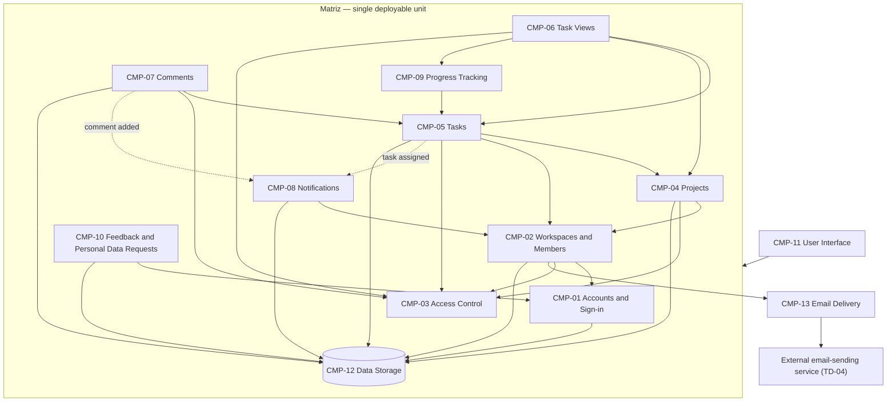
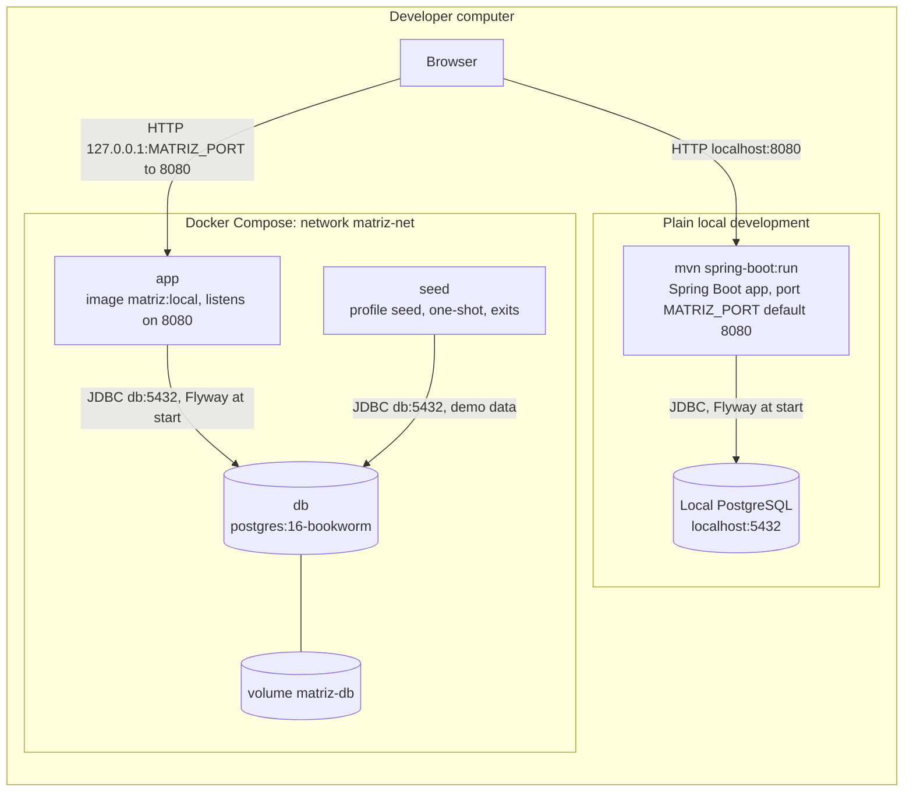
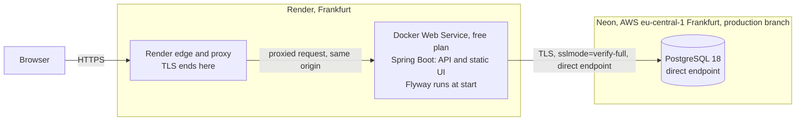
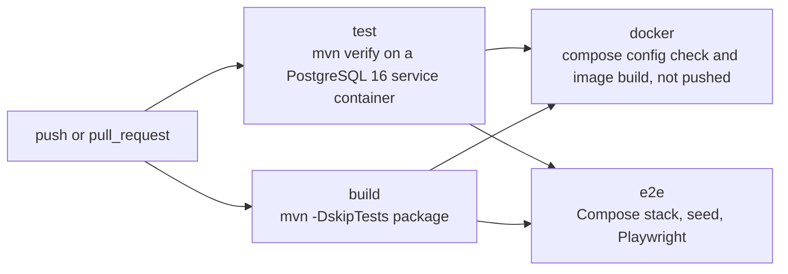

# Matriz — Architecture

> **Status:** decided on 2026-11-05 by the project decision-maker (KC-01). This decision covers the architectural style and the logical components of the MVP. The language, framework, front-end approach and database are chosen under [Technology stack](#technology-stack) (confirmed on 2026-11-12). Hosting was decided on 2026-11-19 (Render for the application, Neon for the database; decided, not yet deployed; see [Technology stack](#technology-stack)); the remaining choices are listed under [Pending decisions](#pending-decisions). Requirement IDs are defined in [requirements.md](requirements.md), user stories in [user-stories.md](user-stories.md), and constraints, assumptions and pending decisions in [constraints.md](constraints.md).

## Context

The MVP is limited to FR-01 to FR-22 and NFR-01 to NFR-10 ([MVP scope](requirements.md#mvp-scope)). The forces that shape the architecture are:

| Force | Source | Status |
|---|---|---|
| The development team is one person, the project decision-maker. | KC-08 | Fact |
| The budget is limited. | KC-04, AQ29 | **Assumption** |
| The first release is expected within a few months, with no fixed deadline. | KC-05, AQ30 | **Assumption** |
| The pilot has tens of teams and up to a few hundred users; growth to thousands is possible within one to three years. | NFR-05, AQ25 | **Assumption** |
| Each organization can see and change only its own data. | NFR-01, SP-02 | Requirement (basis: AQ24, **assumption**) |
| No successfully saved change is lost. | NFR-03 | Requirement (basis: AQ27, **assumption**) |
| Availability during working hours; brief interruptions are tolerable. | NFR-04 | Requirement (basis: AQ27, **assumption**); target pending PD-15 |
| Strict data-protection rules apply; personal-data requests may be handled manually. | NFR-02, FR-21 | Requirement (basis: AQ24, **assumption**) |
| The product will change after the pilot: 23 product decisions are still pending, 27 features are planned for later releases and 3 are not planned. | [Pending product decisions](constraints.md#pending-product-decisions), [Features outside the initial scope](requirements.md#features-outside-the-initial-scope), OBJ-05 | Fact about the documentation |
| No technology had been chosen when the architectural style was decided. The stack was chosen later; see [Technology stack](#technology-stack). | KC-03 | Fact |

The last two forces matter as much as the first: the MVP must be cheap to build and run, and it must also be easy to change once the pending decisions are made and pilot feedback arrives.

## Options considered

Three architectural styles were compared using the same seven criteria.

- **Monolith:** one deployable unit with no enforced internal boundaries.
- **Modular monolith:** one deployable unit divided into modules with explicit responsibilities, public interfaces and data ownership.
- **Microservices:** several independently deployed services, each owning its data and communicating over the network.

| Criterion | Monolith | Modular monolith | Microservices |
|---|---|---|---|
| **Development complexity** | Lowest at the start. | Low. Requires discipline to keep module boundaries, a small cost up front. | High. Network calls, distributed data, and workspace isolation (NFR-01) and permissions (FR-04) repeated in every service. |
| **Speed of delivery** | Fastest start. | Nearly as fast as a monolith. | Slowest: deployment, monitoring and inter-service communication must exist before the first feature ships (conflicts with AQ30). |
| **Maintainability** | Degrades as features are added: permission rules and data access spread across the code. Risky given 23 pending decisions and 27 later features. | Good. Most pending decisions change one module (for example PD-01, PD-02 and PD-17 change Access Control). Later features have a natural place. | Strong boundaries, but decisions that span several FRs (most PDs do) need coordinated changes across services. |
| **Scalability** | Scales as a whole unit. Enough for the pilot load (NFR-05, AQ25). | Same as a monolith. A module can be extracted later if it alone needs to scale. | Independent scaling per service, which the pilot load (NFR-05, AQ25) does not need. |
| **Operational and deployment effort** | Lowest: one unit, one data store. | Lowest: one unit, one data store. Manageable by one person. | Highest: many deployable units, each to monitor, secure and back up. Not manageable by one person on a limited budget (AQ29), and each service is a new point of failure for NFR-04. |
| **Testing** | Simple end-to-end tests. Isolating business rules gets harder over time. | Modules can be tested in isolation and end-to-end. NFR-01 and NFR-03 can be checked at one data-access boundary. | Hardest: contract and integration testing across services. NFR-03 is harder without a single transaction, for example deleting a task while keeping progress counts correct (AC-17.3). |
| **Fit with the MVP and constraints** | Good for the pilot, weak for the changes expected after it. | Best fit: low cost now, room to change later. | Poor fit: costs that the MVP's size, team and load do not justify. |

## Decision

**The MVP of Matriz is built as a modular monolith:** a single deployable unit with one logical data store, divided into the modules listed under [Components and responsibilities](#components-and-responsibilities).

The modules follow four rules:

1. **Explicit interfaces.** A module uses another module only through that module's public interface, never through its internal code or its data.
2. **Data ownership.** Each module owns its data. No module reads or changes another module's data directly.
3. **One-way dependencies.** Module dependencies form no cycles. Where a module must react to something that happens in another, it subscribes to an event the other module publishes inside the application (for example, Notifications reacts to "task assigned" from Tasks).
4. **Workspace scoping.** Every record that belongs to a workspace is marked with its workspace, and every read or change is limited to the signed-in member's workspace (NFR-01, SP-02).

| Approved by | Date |
|---|---|
| Project decision-maker | 2026-11-05 |

## Justification

### Why the modular monolith fits the MVP

- **One person can build and run it.** With a one-person team, a limited budget (AQ29, **assumption**) and a first release within a few months (AQ30, **assumption**), a single deployable unit keeps setup, deployment, monitoring and backup (TD-05, TD-06) to one of each.
- **It handles the expected load.** The pilot of tens of teams and a few hundred users (NFR-05, AQ25, **assumption**) does not require independent scaling of parts of the system.
- **It makes the critical non-functional requirements simple to meet.** One data store lets related changes be saved together or not at all, which protects saved work (NFR-03) and keeps progress counts consistent with tasks (FR-18, AC-17.2, AC-17.3). Workspace isolation (NFR-01) is enforced at one data-access boundary instead of in every service.
- **It absorbs the pending decisions.** Many pending product decisions change rules inside one area: permissions (PD-01, PD-02, PD-03, PD-17), task rules (PD-04, PD-06, PD-11) or progress rules (PD-07, PD-08). Module boundaries keep each change contained.
- **It keeps the growth path open.** If a module later needs to scale or be released separately (see [Conditions for revisiting the decision](#conditions-for-revisiting-the-decision)), its explicit interface and its own data make it possible to extract.

### Why the other options were rejected

- **Monolith:** it would be marginally faster to start, but nothing would stop permission checks, workspace scoping and task rules from spreading across the code. With 23 pending decisions and 27 later features, that would make every change riskier, especially for NFR-01 and SP-03, where a missed check is a data leak.
- **Microservices:** they solve problems Matriz does not have yet (independent scaling, many teams releasing in parallel) and add costs it cannot carry: several deployable units for one person, network failures that threaten NFR-04, and cross-service consistency that threatens NFR-03.

### Trade-offs and risks accepted

- **The whole unit scales and fails together.** A fault in one module can affect all of Matriz. This is accepted because NFR-04 tolerates brief interruptions (AQ27, **assumption**).
- **Boundaries depend on discipline.** Nothing in the deployment stops one module from reaching into another. How boundaries are checked is a pending decision (TD-12).
- **All modules are released together.** A change to one module means redeploying the whole unit. With one developer, this costs little.
- **A small up-front cost.** Defining interfaces and data ownership takes slightly more effort than a plain monolith.

## Consequences

### Positive

- One unit to build, test, deploy, monitor and back up.
- Workspace isolation (NFR-01) and no loss of saved work (NFR-03) are enforced in one place.
- Permission rules (FR-04, FR-05) live in one module, Access Control, so the outcomes of PD-01, PD-02, PD-03 and PD-17 change one place.
- Each FR has a clear owning module (see [Requirement coverage](#requirement-coverage)), which supports traceability under AGENTS.md W3.
- Modules can be extracted into separate services later without redesigning their responsibilities.

### Negative

- No independent scaling or independent release of modules.
- A defect in one module can take down the whole unit.
- Boundary rules must be checked continuously, or the design will drift towards a plain monolith.
- Events inside the application add a little indirection compared with direct calls.

## Components and responsibilities

Component IDs (CMP-xx) are new in this document. Names use the terminology of the existing documentation.

### Feature modules

| ID | Component | Responsibilities | Related FRs / user stories | Main dependencies |
|---|---|---|---|---|
| CMP-01 | **Accounts and Sign-in** | Creates personal accounts (one per person) after checking the account rules (name, email, password; BR-24, SP-10), handles sign-up, sign-in and sign-out, limits sign-up and sign-in attempts per client address (NFR-11, counters in memory, address of the direct connection until TD-13 is decided), and identifies the signed-in person for every request. Accounts are person-level, not workspace-level, so they work whichever way PD-16 is decided. | FR-01, SP-01, SP-08 to SP-10, NFR-11; US-01, US-22 | Data Storage |
| CMP-02 | **Workspaces and Members** | Creates workspaces. Sends, tracks and accepts invitations by email address. Deactivates members. Assigns and changes roles. Refuses duplicate members and keeps at least one Workspace Administrator. Provides each member's role and status to other modules. | FR-02, FR-03, FR-04 (role assignment), SP-04, SP-07; US-02, US-03, US-04, US-05; EC-01, EC-02, EC-03 | Accounts and Sign-in, Access Control, Email Delivery, Data Storage |
| CMP-03 | **Access Control** | Holds the permission rules in one place: what each of the four roles (Workspace Administrator, Project Manager, Team Member, Viewer) may see and change, the Viewer's read-only access, and the rule that a member can delete only the tasks they created. Other modules ask it before every action and pass the facts it needs (the member's role, project membership, task creator). | FR-04 (permissions), FR-05, FR-09 (deletion rule), SP-03; US-19; AC-03.4, AC-11.3, AC-19.2 | None (it receives the facts it needs from the asking module) |
| CMP-04 | **Projects** | Creates, edits and archives projects (name, description, owner, start date, due date). Manages project members, including Viewers. Lists all projects in the workspace with owner and due date. | FR-06, FR-07, FR-08; US-06, US-07, US-08, US-09, US-19 (AC-19.1); EC-09 | Workspaces and Members, Access Control, Data Storage |
| CMP-05 | **Tasks** | Creates, edits and deletes tasks, with a required title and a description, and records who created each task. Keeps exactly one owner per task, who must be a project member. Holds due dates and the three statuses (To do, In progress, Done; new tasks start as To do). Keeps tasks of deactivated members. Publishes "task assigned" and "task status changed" events. | FR-09, FR-10, FR-11, FR-12; US-10, US-11; EC-04, EC-06, EC-07, EC-09 | Projects, Workspaces and Members, Access Control, Data Storage |
| CMP-06 | **Task Views** | Provides the project task list (owner, status, due date), "My tasks" across projects ordered by due date with the earliest first, and filters by owner, status or due date. Shows the overdue marking supplied by Progress Tracking. | FR-13, FR-14, FR-15; US-12, US-13, US-14, US-19; AC-18.4 | Tasks, Projects, Progress Tracking, Access Control |
| CMP-07 | **Comments** | Adds comments to tasks and refuses empty or space-only comments. Publishes a "comment added" event. | FR-16; US-15; EC-08 | Tasks, Access Control, Data Storage |
| CMP-08 | **Notifications** | Creates in-app notifications when a member is assigned a task and when someone comments on a task they own, and shows each member their notifications. | FR-17; US-16 | Tasks and Comments (subscribes to their events), Workspaces and Members, Data Storage |
| CMP-09 | **Progress Tracking** | Derives each project's progress as "N of M tasks done" (including "0 of 0 tasks done") and decides whether a task is overdue: due date earlier than today and status not Done; a task without a due date is never overdue. | FR-18, FR-19; US-17, US-18; EC-05, EC-06 | Tasks |
| CMP-10 | **Feedback and Personal Data Requests** | Receives feedback (problem reports and suggestions) from members. Records requests for a copy or deletion of personal data, so the support team can handle them manually in the MVP. | FR-20, FR-21, SP-05, NFR-02; US-20, US-21 | Accounts and Sign-in, Data Storage |

### Cross-cutting elements

| ID | Component | Responsibilities | Related requirements | Main dependencies |
|---|---|---|---|---|
| CMP-11 | **User Interface** | Presents every MVP function on a computer, in the launch language. Every function is usable without a mouse, and no information relies on colour alone (including the overdue marking). Combines data from several modules on one screen, for example the project list with each project's progress (AC-17.1). Hides actions that Access Control does not allow. | All user-facing FRs, NFR-06, NFR-07, NFR-08, NFR-09; AC-18.1 | All feature modules, through their public interfaces |
| CMP-12 | **Data Storage** | Holds the data of all modules in one logical store, with each module owning its own data. Limits every read and change to the signed-in member's workspace. Saves the changes of one action together or not at all. Stores no payment data. | NFR-01, NFR-03, NFR-05, NFR-10, SP-02, SP-06 | None |
| CMP-13 | **Email Delivery** | Sends invitation emails. It is not used for email notifications (F37), which are outside the initial scope. | FR-03; AC-03.1 | An external email-sending service, pending TD-04 |

The progress indicator is shown in the project list (AC-17.1), but Projects does not depend on Progress Tracking. The User Interface combines the two, which keeps the dependency between Projects, Tasks and Progress Tracking one-way.

### Requirement coverage

| FR | Covered by |
|---|---|
| FR-01 Sign up and sign in | CMP-01 |
| FR-02 Workspace creation | CMP-02 |
| FR-03 Invite and remove members | CMP-02, CMP-13 |
| FR-04 Roles and permissions | CMP-02, CMP-03 |
| FR-05 Read-only access | CMP-03, CMP-11 |
| FR-06 Create, edit and archive projects | CMP-04 |
| FR-07 Project members | CMP-04 |
| FR-08 Project list | CMP-04, CMP-11 |
| FR-09 Create, edit and delete tasks | CMP-05, CMP-03 |
| FR-10 Assign a responsible person | CMP-05 |
| FR-11 Due dates | CMP-05 |
| FR-12 Task status | CMP-05 |
| FR-13 Project task list | CMP-06 |
| FR-14 "My tasks" | CMP-06 |
| FR-15 Filter tasks | CMP-06 |
| FR-16 Task comments | CMP-07 |
| FR-17 In-app notifications | CMP-08 |
| FR-18 Project progress indicator | CMP-09, CMP-11 |
| FR-19 Overdue highlighting | CMP-09, CMP-06, CMP-11 |
| FR-20 Send feedback | CMP-10 |
| FR-21 Personal data requests | CMP-10 |

| NFR | Addressed by |
|---|---|
| NFR-01 Workspace data isolation | CMP-12 (workspace scoping), decision rule 4 |
| NFR-02 Data protection | CMP-10, CMP-12; details pending TD-02, TD-09, PD-18, PD-19 |
| NFR-03 No loss of saved work | CMP-12; details pending TD-05 |
| NFR-04 Availability during working hours | The single deployable unit; target pending PD-15, approach pending TD-06 |
| NFR-05 Capacity | The single deployable unit, scaled as a whole; targets pending PD-15 |
| NFR-06 Accessibility | CMP-11 |
| NFR-07 Learnability | CMP-11 |
| NFR-08 Primary use on computers | CMP-11; access method pending TD-01 |
| NFR-09 One interface language | CMP-11; language pending PD-13 |
| NFR-10 Data sensitivity | CMP-12 stores no payment data; no component handles payments |
| NFR-11 Abuse protection of sign-up and sign-in | CMP-01 (limits kept in memory); how the client address is read behind a proxy is pending TD-13 |

## Component diagram

Solid arrows point from a component to a component it depends on. Dashed arrows show events published inside the application.

## Technology stack

> **Status:** proposed on 2026-11-05 and **confirmed on 2026-11-12 by the project decision-maker** (KC-01). It resolves TD-10 and TD-11 and narrows TD-01. It does **not** decide TD-04, TD-05, TD-06, TD-07, TD-08, TD-09 or TD-12. TD-03 was decided on 2026-11-12 (session cookie with BCrypt passwords; see the [decision log](constraints.md#decision-log)), and TD-02 was decided on 2026-11-19 (see the Hosting row below). The JaCoCo row was added on 2026-11-17 (see the [decision log](constraints.md#decision-log)). The Docker, Docker Compose and GitHub Actions row was added on 2026-11-18 and the Hosting row on 2026-11-19.

### Summary

| Layer | Choice |
|---|---|
| Language and back-end framework | **Java 21 (LTS) with Spring Boot 3** (Spring Web, Spring Security, Spring Data JPA, Bean Validation) |
| Front-end approach | **Static HTML, CSS and plain JavaScript**, served by the same Spring Boot application and calling the REST API in [openapi.yaml](../openapi.yaml) |
| Database | **PostgreSQL** (relational), installed on the developer's computer or run as the PostgreSQL 16 container of `compose.yaml` |
| Supporting tools | **Maven** (build), **Hibernate** through Spring Data JPA (data access), **Flyway** (schema migrations), **JUnit 5 with Spring Boot Test and MockMvc** (tests) |
| Fonts | **Inter** and **Space Grotesk** (SIL Open Font License 1.1), self-hosted as woff2 files (latin subset, from the npm packages `@fontsource/inter` and `@fontsource/space-grotesk` 5.3.0) in `src/main/resources/static/css/fonts`; no font service is called (added 2026-11-19) |
| Code coverage measurement | **JaCoCo** (Maven plugin 0.8.14, added 2026-11-17); the report is written to `target/site/jacoco` at `mvn verify`; no coverage thresholds |
| Packaging and continuous integration | **Docker** (one image of the application, Eclipse Temurin 21), **Docker Compose** (PostgreSQL 16 and the application on one machine, on the dedicated network `matriz-net`) and **GitHub Actions** (tests, image build, end-to-end test); added 2026-11-18, see the [decision log](constraints.md#decision-log). Not a hosting decision: images are not published. |
| Hosting (decided, 2026-11-19; **not yet deployed**, no public URL exists) | **Render** (one Docker Web Service, free plan) for the application and **Neon** (managed PostgreSQL 18, direct connection endpoint, TLS) for the database; regions: Render Frankfurt (EU Central; exact name [TO CONFIRM]), Neon AWS Europe Central 1 (Frankfurt, `eu-central-1`), using the `production` (default) branch of the existing Neon project; Docker Compose and CI keep PostgreSQL 16; approved by the project decision-maker (KC-01), see the [decision log](constraints.md#decision-log). One Render Web Service serves the API and the static interface from the same origin; a separate Render Static Site is not used, because `onrender.com` subdomains are different sites and the session and CSRF cookies are same-site only (TD-03); the `MATRIZ_API_BASE_URL` rule is unchanged. The public deployment has no demo data. Backup (TD-05) and availability (TD-06) stay pending. Risk for NFR-04, not a decision: the free plan may stop the service when idle and sessions are kept in memory, so a stop or restart ends every session [TO CONFIRM]. Compatibility with PostgreSQL 18 on Neon, the exact Render region name, free-plan limits, and TLS and connection options are not verified [TO CONFIRM]. Accounts on the public site are created by public sign-up (INC-12). |

### Inputs specific to this decision

These come from the project decision-maker's request on 2026-11-05. Items marked TS-Ax are **assumptions** made for this decision and must be confirmed.

| Input | Source | Status |
|---|---|---|
| The developer is one student, familiar with Java and JavaScript. | Project decision-maker, 2026-11-05; KC-08 | Stated input |
| The MVP must be built in **1 week**. | Project decision-maker, 2026-11-05 | Stated input. **Conflicts with AQ30** ("within a few months"); see the report. |
| Matriz runs **locally** for the course; there is no hosted deployment. | Project decision-maker, 2026-11-05 | Stated input, **superseded in part on 2026-11-19**: hosting was chosen (Render and Neon, see the Hosting row in the summary above and the [decision log](constraints.md#decision-log)), but nothing is deployed yet, so Matriz still runs only locally and in CI. TD-05 and TD-06 remain pending for any deployment. |
| **TS-A1.** No course or instructor requirement fixes a technology. | None was given | **Assumption** |
| **TS-A2.** "Familiar with JavaScript" means plain JavaScript in the browser, not TypeScript or a front-end framework such as React. | Team context | **Assumption** |
| **TS-A3.** The developer can install a JDK and PostgreSQL on their own computer. | Local running | **Assumption** |

The comparison considers only FR-01 to FR-22 and NFR-01 to NFR-10. No option was rated on how well it supports features outside the initial scope.

### Evaluation criteria

| ID | Criterion | Why it matters for Matriz |
|---|---|---|
| C1 | Fit with architecture and API style | The MVP is a modular monolith with explicit module interfaces and data ownership (decision rules 1–3) and a REST/JSON API ([openapi.yaml](../openapi.yaml)) with distinct 400, 401, 403, 404 and 422 responses (API-A2, API-A3). |
| C2 | Fit with the data model | [database.md](database.md) has 11 entities, 18 relationships (R-01 to R-18), composite keys (ProjectMember), composite uniqueness (Member: workspace_id + account_id) and unique email (DA-01). |
| C3 | Team familiarity and learning curve | One developer (KC-08) who knows Java and JavaScript; there is no time to learn a new language. |
| C4 | Development speed for the MVP | 1 week for 22 functional requirements (stated input). |
| C5 | Security support | Signed-in access only (FR-01, SP-01), role-based permissions in one place (FR-04, FR-05, SP-03, CMP-03), deactivated members locked out (SP-04), workspace isolation (NFR-01, SP-02), input validation (AC-10.2, EC-08), safe queries, and support for password hashing (TD-03, decided 2026-11-12: passwords). |
| C6 | Testing support | Acceptance criteria and edge cases (for example AC-10.x, AC-11.x, AC-17.x, EC-03) must be checkable; NFR-01 and NFR-03 should be testable at one boundary (see Justification above). |
| C7 | Ecosystem, documentation and community | A single student developer relies on documentation and examples to solve problems quickly. |
| C8 | Ease of local setup | Matriz runs locally for the course (stated input). |
| C9 | Long-term maintainability | 23 product decisions are pending and the product will change after the pilot (OBJ-05); the stack should not make those changes harder. |

### Language and back-end framework

| Criterion | Java 21 + Spring Boot 3 | TypeScript + NestJS (Node.js) | JavaScript + Express (Node.js) |
|---|---|---|---|
| C1 Architecture and API | **High.** Packages per module (CMP-01 to CMP-10), dependency injection for public interfaces, in-process events (`ApplicationEventPublisher`) for "task assigned" and "comment added" (rule 3), and `@ControllerAdvice` to map errors to 400/401/403/404/422. | **High.** Modules, providers and exception filters map closely to the CMP structure and the API's error codes. | **Medium.** Routing is simple, but module structure, event handling and error mapping must be built by hand, so boundaries depend on discipline alone. |
| C2 Data model | **High.** JPA maps every entity, composite key and relationship; constraints live in the database. | **Medium.** TypeORM or Prisma can map the model, but composite keys and unique pairs are less smooth than in JPA. | **Medium.** Depends on choosing and configuring a separate ORM or query builder. |
| C3 Familiarity | **High.** The developer knows Java. Spring has a learning curve, mainly Spring Security. | **Low.** Needs TypeScript and NestJS's decorator-based style, neither of which is known (TS-A2). | **High.** Plain JavaScript is known; Express is small. |
| C4 Speed for 1 week | **High.** Spring Initializr generates a working project; validation, security, data access and JSON handling are built in. | **Medium.** Structured, but learning TypeScript and NestJS costs part of the week. | **Medium.** Fast to start, but choosing and wiring validation, authentication, ORM and error handling takes time. |
| C5 Security | **High.** Spring Security provides authentication, method-level authorization, CSRF protection and password encoders (BCrypt); Bean Validation checks input; JPA uses parameterized queries. | **High.** Guards, Passport and class-validator cover the same needs. | **Medium.** Possible with Passport, a validation library and a hashing library, but each is a separate choice and easier to misconfigure. |
| C6 Testing | **High.** JUnit 5, Spring Boot Test and MockMvc test each module and each endpoint, including 401/403/404 cases. | **High.** Jest and Supertest are well supported. | **Medium.** Jest and Supertest work, but the test setup is assembled by hand. |
| C7 Ecosystem | **High.** Very mature, extensive official guides and community answers. | **Medium.** Good documentation, smaller community than Spring or Express. | **High.** Very large community, but advice is fragmented across many library combinations. |
| C8 Local setup | **Medium.** Needs a JDK; the app runs as one executable JAR. | **Medium.** Needs Node.js and a TypeScript build step. | **High.** Needs Node.js only. |
| C9 Maintainability | **High.** Static typing and enforced structure help when PD-01, PD-03 or PD-17 change permission rules in CMP-03. | **High.** Static typing and enforced modules. | **Low.** No static typing and no enforced structure; rules risk spreading across the code, which the modular monolith decision explicitly avoids. |

### Front-end approach

The MVP includes a web user interface (CMP-11, NFR-08). Options are compared with the chosen back end.

| Criterion | Static HTML, CSS and JavaScript calling the REST API | Server-rendered templates (Thymeleaf) | Single-page app (React + Vite) |
|---|---|---|---|
| C1 Architecture and API | **High.** The UI uses the same REST API defined in openapi.yaml, and is served by the same deployable unit, so there is one set of endpoints and one unit. | **Medium.** Fits one deployable unit, but pages are produced by separate controllers, so every feature needs both page handlers and the REST API. | **High.** Consumes the REST API directly, but is usually built and served as a second project. |
| C2 Data model | **High.** Uses the API's JSON; no direct data access. | **High.** Uses the same services. | **High.** Uses the API's JSON. |
| C3 Familiarity | **High.** Plain JavaScript is known (TS-A2). | **Medium.** Java is known; Thymeleaf syntax is new but small. | **Low.** React, JSX and its state model are new (TS-A2). |
| C4 Speed for 1 week | **Medium.** No build step, but DOM updates are written by hand for a few screens (dashboard, project list, task list, task detail, members, forms). | **High** for pages alone, **Medium** overall because the REST API must also be built. | **Low.** Learning React and setting up the toolchain costs part of the week. |
| C5 Security | **Medium.** Must avoid inserting user text as HTML (use `textContent`) and handle the sign-in credential carefully (TD-03, decided 2026-11-12). | **High.** Escapes output by default and works with Spring Security's CSRF protection. | **Medium.** Escapes by default, but credential handling between two projects adds work. |
| C6 Testing | **Medium.** API tests cover the rules; the UI itself is checked manually against the acceptance criteria. | **Medium.** Controllers are testable with MockMvc; page rendering is checked manually. | **Medium.** Component tests are possible but add another toolchain. |
| C7 Ecosystem | **High.** Web standards, documented by MDN. | **High.** Mature and well documented. | **High.** Very large community. |
| C8 Local setup | **High.** Files are served by the Spring Boot application; nothing else to install. | **High.** Part of the Spring Boot application. | **Medium.** Needs Node.js, npm and a second dev server. |
| C9 Maintainability | **Medium.** Fine for the MVP's small number of screens; becomes harder if the UI grows a lot after the pilot. | **Medium.** Easy to maintain, but duplicates the API. | **High.** Scales well to larger interfaces. |

Semantic HTML forms, links and buttons work without a mouse by default, which supports NFR-06 with any of the three options.

### Database

| Criterion | PostgreSQL | Embedded relational database (H2 or SQLite) | MongoDB (document store) |
|---|---|---|---|
| C1 Architecture and API | **High.** One logical store for all modules (CMP-12); transactions save the changes of one action together (rule for CMP-12, NFR-03). | **High.** Same relational model and transactions. | **Medium.** Multi-document transactions exist but are more complex; the data model is highly connected. |
| C2 Data model | **High.** Primary and foreign keys for R-01 to R-18, composite keys (ProjectMember), unique constraints (Account.email per DA-01; Member workspace_id + account_id), CHECK constraints for the enums (role, status, notification type, request type), and a unique, nullable Notification.comment_id for R-16 (0..1 to 0..1). | **Medium.** Supports keys and uniqueness; SQLite has weaker type checking and limited ALTER TABLE support. | **Low.** No foreign keys; uniqueness across collections and relationships such as ProjectMember must be enforced in code. |
| C3 Familiarity | **Medium.** Standard SQL; widely taught. | **Medium.** Standard SQL. | **Low.** Different data and query model. |
| C4 Speed for 1 week | **Medium.** A local install takes some time once (TS-A3). | **High.** No installation. | **Medium.** Install plus a new query model. |
| C5 Security | **High.** Constraints in the database back up the application's checks; parameterized queries through JPA. | **Medium.** Constraints exist; file-based storage relies on file permissions. | **Medium.** Schema rules depend on the application. |
| C6 Testing | **High.** Tests can run against a local PostgreSQL test database, the same engine used to run Matriz. | **High.** Very easy to start for tests. | **Medium.** Needs a running server for tests. |
| C7 Ecosystem | **High.** Very mature, excellent documentation, first-class Spring support. | **High.** Well known; H2 is common in Spring examples. | **High.** Large community. |
| C8 Local setup | **Medium.** One install and one database to create. | **High.** Runs inside the application or as a single file. | **Medium.** One install. |
| C9 Maintainability | **High.** Same engine can be used if Matriz is later deployed; handles the expected growth (NFR-05, AQ25). | **Low.** Usually needs replacing before any real deployment, with SQL dialect differences. | **Medium.** Flexible schema, but integrity rules stay in code. |

### Supporting tools

Only tools needed to build, store data and test are chosen. Each is compared with one realistic alternative using the same criteria, in short form.

| Need | Chosen | Alternative | Why the choice |
|---|---|---|---|
| Build | **Maven** | Gradle | Both work with Spring Boot (C1, C8). Maven's declarative configuration has the most examples and the least to learn (C3, C4, C7). |
| Data access | **Spring Data JPA (Hibernate)** | Spring JDBC (`JdbcClient`) with hand-written SQL | JPA maps the 11 entities and their relationships with little code (C2, C4) and uses parameterized queries (C5). Plain SQL gives more control but takes longer to write for every operation (C4). Risk: lazy loading and extra queries must be watched (C9). |
| Schema | **Flyway** migrations | Hibernate automatic schema generation | Versioned SQL scripts declare every key and constraint from database.md exactly and keep the schema in Git (C2, C9). Automatic generation is faster at first but can miss or change constraints and is not reviewable (NFR-03). |
| Tests | **JUnit 5, Spring Boot Test, MockMvc** | — | Included with Spring Boot; there is no simpler realistic alternative in the Java ecosystem (C6). |

### Decision and justification

**The Matriz MVP is built with Java 21 and Spring Boot 3, a static HTML, CSS and JavaScript front end served by the same application, and a PostgreSQL database**, with Maven, Spring Data JPA, Flyway and JUnit 5.

- **Java and Spring Boot** score High on fit, speed, security, testing and maintainability, and use the language the developer already knows. Module packages, in-process events and one place for permission rules (CMP-03, through Spring Security and method-level checks) follow decision rules 1–3 directly. Everything needed for the two operations in openapi.yaml is built in: JSON request handling, Bean Validation for 422 responses, a parse-error handler for 400, Spring Security for 401 and 403, and workspace-scoped queries returning 404 for other workspaces (API-A3).
- **Static HTML, CSS and JavaScript** keeps one deployable unit and one API, uses the JavaScript the developer knows, and needs no front-end toolchain, which matters most in a 1-week schedule.
- **PostgreSQL** represents every entity, relationship and constraint in database.md in the database itself (see the C2 row), saves related changes together (NFR-03) and stays usable if Matriz is deployed later.

**Rejected alternatives:**

- **TypeScript + NestJS:** a good architectural fit, but the developer would have to learn TypeScript and NestJS within the 1-week schedule (C3, C4).
- **JavaScript + Express:** familiar and quick to start, but validation, security, data access and module structure would each need separate choices and wiring, and its lack of structure works against the modular monolith (C1, C5, C9).
- **Thymeleaf:** strong security defaults, but every screen would need page controllers in addition to the REST API that openapi.yaml already defines (C1, C4).
- **React + Vite:** best for large interfaces, but new to the developer and adds a second project and toolchain (C3, C4, C8).
- **H2 or SQLite:** easiest to set up, but weaker for durability and constraints and usually replaced before any real deployment (C2, C9).
- **MongoDB:** the data is relational, with many foreign keys and uniqueness rules that a document store cannot enforce (C2).

**Trade-offs and risks accepted:**

- Spring Security has a learning curve, mainly for sign-in (TD-03 was decided on 2026-11-12).
- Hand-written front-end JavaScript is slower per screen than a framework and harder to maintain if the UI grows a lot.
- PostgreSQL must be installed locally (TS-A3), which costs some setup time in the first day.
- JPA can generate inefficient queries if relationships are loaded carelessly.
- The 1-week schedule is tight for 22 functional requirements whatever the stack; this choice reduces, but does not remove, that risk.

### How the stack supports the documented design

| Area | How |
|---|---|
| Modular monolith (decision rules 1–3) | One Spring Boot application. One Java package per module (CMP-01 to CMP-10) exposing a public service interface. In-process events for "task assigned" and "comment added". How boundaries are checked stays pending (TD-12); the stack allows automated checks or code review. |
| Workspace scoping (rule 4, NFR-01, SP-02) | Every repository query is limited to the signed-in member's workspace, in the data-access layer (CMP-12). Whether every table carries workspace_id directly is still open (database.md, DA-09). |
| Data model (database.md) | 11 entities become 11 tables created by Flyway migrations, with primary keys, foreign keys for R-01 to R-18, composite keys and the unique constraints listed above. Rules that span rows, such as keeping at least one Workspace Administrator (SP-07, R-02), are enforced in CMP-02 inside a transaction. |
| API (openapi.yaml) | `createTask` and `updateTask` become REST controller methods in CMP-05, with request validation and one shared error handler for 400/401/403/404/422. |
| Security (SP-01 to SP-07) | Spring Security requires sign-in for every request (SP-01) and rejects deactivated members (SP-04). Permission rules are checked in CMP-03 (SP-03). Passwords are hashed with BCrypt (TD-03, decided 2026-11-12). No payment data is stored (SP-06). |
| No loss of saved work (NFR-03) | Each action runs in one database transaction. Backup and recovery remain pending (TD-05). |

### Consequences

**Positive**

- One language for the back end and familiar JavaScript for the front end, so the week is spent on features rather than learning.
- Security, validation, data access and testing are covered by mature, documented parts of one framework.
- Data integrity rules from database.md are enforced by the database as well as by the application.
- The same stack can be used if Matriz is later deployed beyond local use.

**Negative**

- Spring Boot is heavier than Express, with more configuration to understand.
- The hand-written front end has no component structure.
- A local PostgreSQL installation is required to run and test Matriz.
- Choosing JPA ties data access to Hibernate's behaviour.

### Conditions for revisiting the technology stack

Revisit this choice, recording the outcome in the [decision log](constraints.md#decision-log), if:

1. A course or instructor requirement fixes a technology (TS-A1).
2. The front end grows beyond what plain JavaScript can maintain, for example after pilot feedback asks for more interactive views; consider a front-end framework then.
3. Matriz is deployed beyond local use; TD-05 and TD-06 must then be decided (TD-02 is decided, 2026-11-19), and the database setup reviewed.
4. A later change of the sign-in method (decided in TD-03 on 2026-11-12) is one that Spring Security does not support well.
5. The development team changes (KC-08) and its skills differ from Java and JavaScript.
6. Performance problems appear that come from the data-access layer rather than from the data model.

## Deployment view

How the single deployable unit (see the [component diagram](#component-diagram)) runs in each environment. It adds no component and decides nothing: hosting is the decision of 2026-11-19 recorded in the [Technology stack](#technology-stack) (Hosting row) and the [decision log](constraints.md#decision-log). Steps, variables and checks are in [deployment.md](deployment.md). Facts about Render and Neon behaviour are not verified [TO CONFIRM]; the hosted deployment is **decided, not yet deployed**, and no public URL exists.

### Local runtime

Two ways to run Matriz on one computer. The Compose variant is exactly `compose.yaml`; the plain variant is the README, [Getting started](../README.md#getting-started).

The database of the Compose stack publishes no port; only `app` reaches it. The `seed` service is not started by `docker compose up`.

### Hosted deployment (decided 2026-11-19, not yet deployed)

One service serves the API and the user interface, so the browser sees one origin and the same-site session and CSRF cookies (TD-03) work. There is no Static Site and no CORS configuration. The internal path from the proxy to the application, the proxy addresses and whether `X-Forwarded-For` is trusted (`SERVER_FORWARD_HEADERS_STRATEGY`, TD-13, pending) are [TO CONFIRM]. The public database has no demo data.

### Continuous integration

`.github/workflows/ci.yml`, run on every push and pull request with read-only permissions. `test` and `build` run first; `docker` and `e2e` run only after both pass. Nothing is published or deployed.

## Implementation notes (2026-11-16)

Recorded during the release review of 2026-11-16 (see the [implementation plan](implementation-plan.md#status-log)). The design above is unchanged; these notes record where the code built so far differs from it or does not yet cover it. None of them is a decision.

| ID | Deviation or gap | Evidence |
|---|---|---|
| AR-01 | The project task list and its filters (FR-13, FR-15) are built in the `tasks` package (CMP-05), not in CMP-06 Task Views, whose package `taskviews` holds no code. Where they belong is pending (release review 2026-11-16, finding R-13 on module placement). | `tasks/TaskService.java`, `tasks/TaskController.java`; `taskviews/package-info.java` |
| AR-02 | CMP-09 Progress Tracking reads Projects and Workspaces as well as Tasks, and checks whether the caller can see a project itself, not through CMP-03 Access Control. The behaviour matches `getProjectProgress`. | `progress/ProgressController.java` (imports `ProjectDirectory`, `MemberDirectory`; visibility check in `progress`) |
| AR-03 | CMP-07 Comments also depends on Projects and Workspaces, besides Tasks and Access Control. | `comments/CommentService.java` (imports `ProjectDirectory`, `MemberDirectory`) |
| AR-04 | Workspace isolation (NFR-01) is checked in the module services through `AccessPolicy.requireWorkspaceAccess`, not by limiting every repository query in the data-access layer (CMP-12). The access tests show NFR-01 holds. | `accesscontrol/AccessPolicy.java`; `tasks/TaskService.java`; `VerificationApiTest` `case08*`, `TaskAccessTest` |
| AR-05 | Not built in this delivery: workspace creation, invitations, role changes and deactivation in CMP-02 (FR-02, FR-03, FR-04); archiving and choosing project members in CMP-04 (FR-06 archive, FR-07); the events of CMP-05 and CMP-07 (no module publishes or subscribes to events); CMP-06 "My tasks" (FR-14); CMP-08 Notifications (FR-17); overdue rules in CMP-09 (FR-19); CMP-10 (FR-20, FR-21); CMP-13 Email. Their packages hold only `package-info.java`, and `storage` (CMP-12) holds no code because Spring Data JPA repositories live in each module. | `email/`, `feedback/`, `notifications/`, `taskviews/`, `storage/` |
| AR-06 | Two packages are not components: `shared` (the API error body and handler, id parsing, page and size parsing, `GET /config.js`) and `seed` (the demo-data command). | `shared/`, `seed/` |

## Pending decisions

### Technical decisions already listed in constraints.md

None of these is decided by this document. The architectural style narrows each one as follows. TD-03 is shown for completeness: it was decided on 2026-11-12 and is no longer pending (see the [decision log](constraints.md#decision-log)).

| ID | Decision | Effect of this architecture |
|---|---|---|
| TD-01 | How users access Matriz on computers | Decides how CMP-11 User Interface is delivered. Narrowed by [Technology stack](#technology-stack): a web interface of static HTML, CSS and JavaScript, used in a browser. |
| TD-02 | Where data is stored and hosted, including the region | Applies to the single logical store, CMP-12. Decided on 2026-11-19: Render (Frankfurt) for the application and Neon (PostgreSQL 18, AWS eu-central-1, `production` branch) for the database; not yet deployed (see the Hosting row in [Technology stack](#technology-stack)). |
| TD-03 | How accounts are created and how sign-in works | Resolved: sign-in 2026-11-12, sign-up 2026-11-18 (see the decision log). Implemented inside CMP-01. |
| TD-04 | How invitation emails are sent | Implemented behind CMP-13. |
| TD-05 | Backup and recovery | Covers one data store. |
| TD-06 | How availability and capacity targets are met and monitored | Applies to one deployable unit. |
| TD-07 | How simultaneous edits to the same task are handled | Implemented inside CMP-05, once PD-11 is decided. |
| TD-08 | How in-app notifications are delivered | Implemented inside CMP-08 and CMP-11. |
| TD-09 | How personal-data requests are received and fulfilled | Implemented inside CMP-10. |
| TD-13 | How the client IP address is read behind a proxy | Applies to the one deployable unit; affects the rate limits in CMP-01 (NFR-11). |

### Technical decisions raised by this document

These are registered under [Pending technical decisions](constraints.md#pending-technical-decisions) in constraints.md.

| ID | Decision | Status |
|---|---|---|
| TD-10 | Programming language and application framework for the deployable unit. | Resolved by [Technology stack](#technology-stack): Java 21 and Spring Boot 3 (confirmed 2026-11-12). |
| TD-11 | Type of data store, for example how it supports saving related changes together (NFR-03) and workspace scoping (NFR-01). TD-02 covers only where data is stored. | Resolved by [Technology stack](#technology-stack): PostgreSQL, a relational database (confirmed 2026-11-12). |
| TD-12 | How module boundaries and the no-cycle rule are checked, for example by automated checks or code review. | Pending |

### Product decisions that affect components

| ID | Affects |
|---|---|
| PD-01, PD-02, PD-03, PD-17 | Permission rules in CMP-03 Access Control (and CMP-02 for PD-02). |
| PD-04, PD-06, PD-11 | Task rules in CMP-05 Tasks, and "My tasks" in CMP-06 for PD-06. |
| PD-05 | Project statuses and archiving in CMP-04 Projects. |
| PD-07, PD-08 | Progress and overdue rules in CMP-09, and ordering in CMP-06 for PD-08. |
| PD-09 | Invitation handling in CMP-02. |
| PD-10 | Tasks of deactivated or removed members, across CMP-02, CMP-04 and CMP-05. If removal must be refused while the person owns tasks (EC-09), the check must be placed so that Projects does not come to depend on Tasks, which would create a cycle. |
| PD-12 | Self-notifications in CMP-08. |
| PD-13 | Launch language in CMP-11. |
| PD-15 | Numeric targets for NFR-02, NFR-04, NFR-05, NFR-06 and NFR-07, and the thresholds for revisiting this decision. |
| PD-16 | Membership of several workspaces: affects CMP-01, CMP-02, CMP-06 ("My tasks") and workspace scoping in CMP-12. |
| PD-18, PD-19 | What a deletion request removes and how requesters are verified, in CMP-10. |
| PD-25, PD-26 | Email verification and password reset in CMP-01 (and CMP-13 Email Delivery if emails are sent, TD-04). |

## Conditions for revisiting the decision

Revisit this decision, recording the outcome in the [decision log](constraints.md#decision-log), if any of the following happens:

1. **Load.** Use grows towards thousands of users (NFR-05, AQ25) and one module, for example Task Views or Notifications, needs more capacity than scaling the whole unit can provide at an acceptable cost. Numeric thresholds depend on PD-15.
2. **Availability.** Once the NFR-04 target is set (PD-15), a fault in one module repeatedly takes down functions that must stay available.
3. **Team.** The development team grows beyond one person to several people or teams who need to release parts of Matriz independently.
4. **Different workloads.** A later feature brings work that does not fit the request-and-response pattern of the MVP, such as scheduled or background processing for F37 Email notifications, F38 Due-date reminders, F43 Reports and export, F47 Import or F48 Connections to other tools. This may justify a separate background component, not necessarily microservices.
5. **Data location.** Data-protection rules or customers require data to be stored in different regions (TD-02, NFR-02), which one data store cannot satisfy.
6. **Boundary erosion.** Module boundaries are repeatedly broken. This is a signal to restore the boundaries first, not to split the system.
7. **Pilot outcome.** The pilot (OBJ-05) leads to a significant change in the product's direction.
