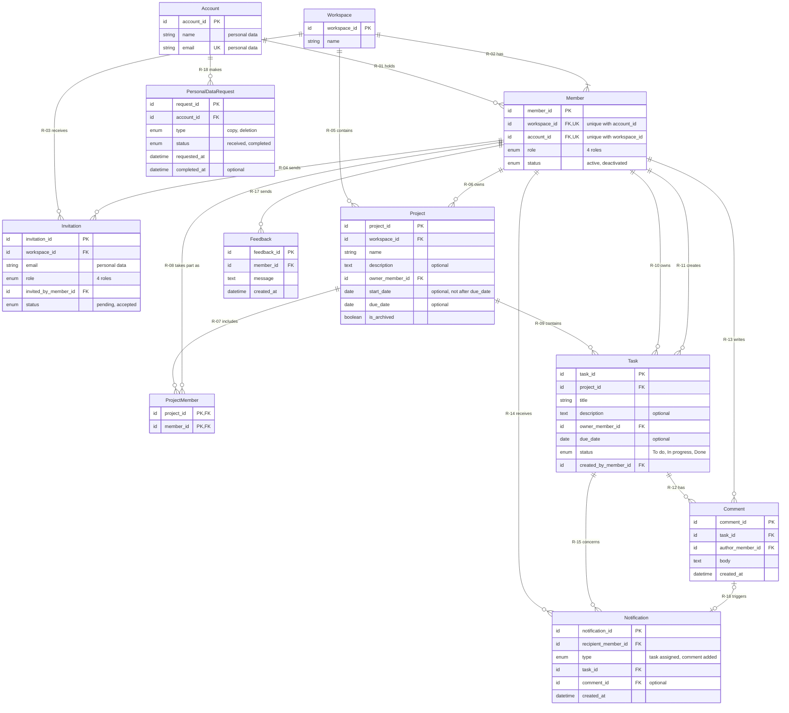

# Matriz — ER Diagram

> Diagram of the MVP data model. Entities, attributes, keys and cardinalities are defined in [database.md](database.md); relationship labels match its R-xx IDs. If the two ever differ, database.md is authoritative and this diagram must be updated.

